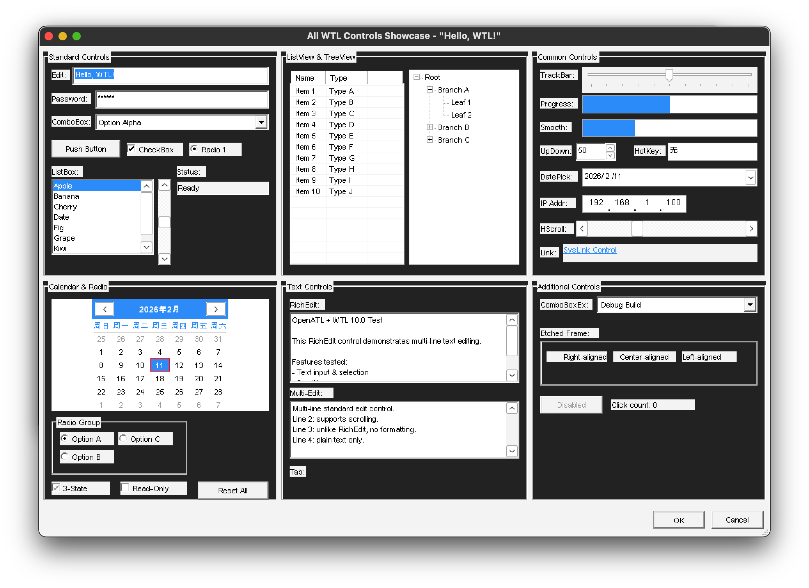

# WTL Test Application

A comprehensive [WTL](https://wtl.sourceforge.io) 10.0 test application built with [OpenATL](https://github.com/kkHAIKE/OpenATL) and [llvm-mingw](https://github.com/mstorsjo/llvm-mingw), demonstrating that WTL programs can be compiled and run using the MinGW toolchain -- enabling Windows WTL application builds on non-Windows platforms (macOS, Linux).

## Screenshot



## Features

- SDI frame window with splitter, tree navigation, and scrollable view
- Menu bar, accelerators, status bar
- All Controls showcase dialog (30+ control types)
- Property sheet with General / Advanced pages
- About dialog
- GDI wrappers, common dialogs, utility classes

## Prerequisites

- [CMake](https://cmake.org) >= 3.14
- [llvm-mingw](https://github.com/mstorsjo/llvm-mingw) cross-compiler toolchain
- [Wine](https://www.winehq.org) (optional, for running on macOS/Linux)

## Setup

1. Download and extract [llvm-mingw](https://github.com/mstorsjo/llvm-mingw/releases).

2. Download [WTL 10.0](https://sourceforge.net/projects/wtl/) and copy the header files into `3rdparty/wtl/include/`:

   ```
   3rdparty/wtl/include/
   ├── atlapp.h
   ├── atlcrack.h
   ├── atlctrls.h
   ├── atlctrlx.h
   ├── atldlgs.h
   ├── atlframe.h
   ├── atlgdi.h
   ├── atlmisc.h
   ├── atlscrl.h
   ├── atlsplit.h
   ├── atluser.h
   ├── atlwinx.h
   └── ...
   ```

3. Edit `CMakeLists.txt` and set `LLVM_PREFIX` to your llvm-mingw installation path:

   ```cmake
   set(LLVM_PREFIX "/your/path/to/llvm-mingw")
   ```

## Build

```bash
mkdir build && cd build
cmake ..
make
```

The output is `build/wtltest.exe`.

## Run (with Wine)

```bash
wine build/wtltest.exe
```

## Project Structure

```
wtltest/
├── CMakeLists.txt
├── main.cpp              # Application source
├── resource.h            # Resource IDs
├── wtltest.rc            # Resource script (menus, dialogs, accelerators)
├── cmake/
│   └── llvm-mingw.cmake  # Cross-compiler toolchain file
└── 3rdparty/
    ├── openatl/          # OpenATL - clean-room ATL for MinGW toolchain
    └── wtl/include/      # WTL 10.0 headers (not included, see Setup)
```

## Support

If you find this project useful, consider [sponsoring my open-source work](https://github.com/sponsors/kkHAIKE).

## License

MIT License. See [LICENSE](LICENSE) for details.
